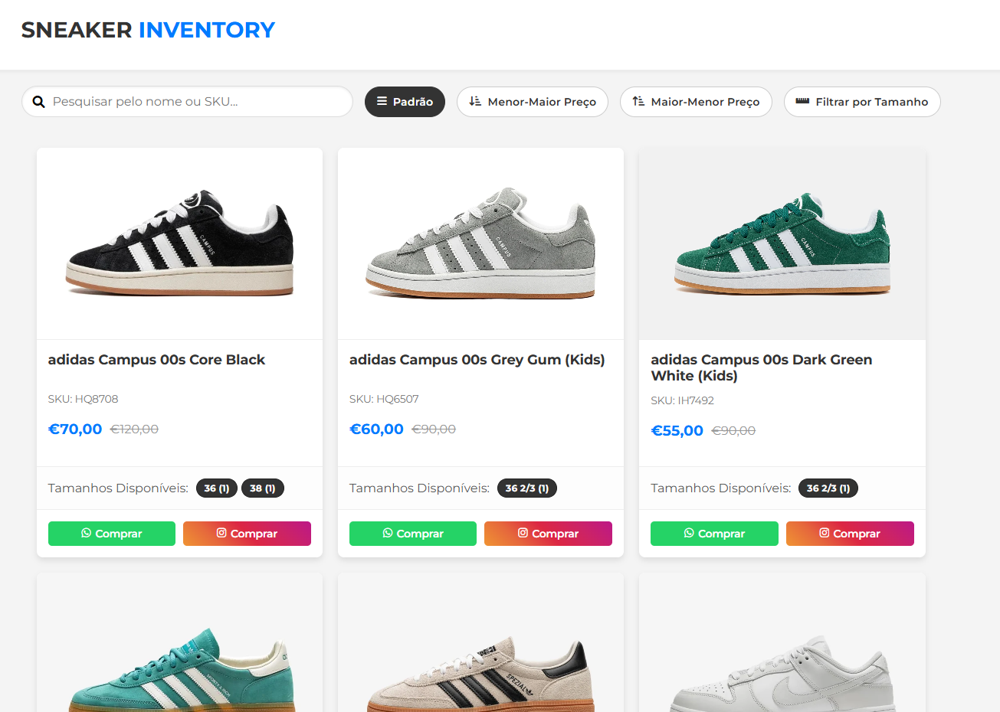
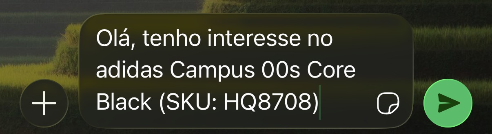
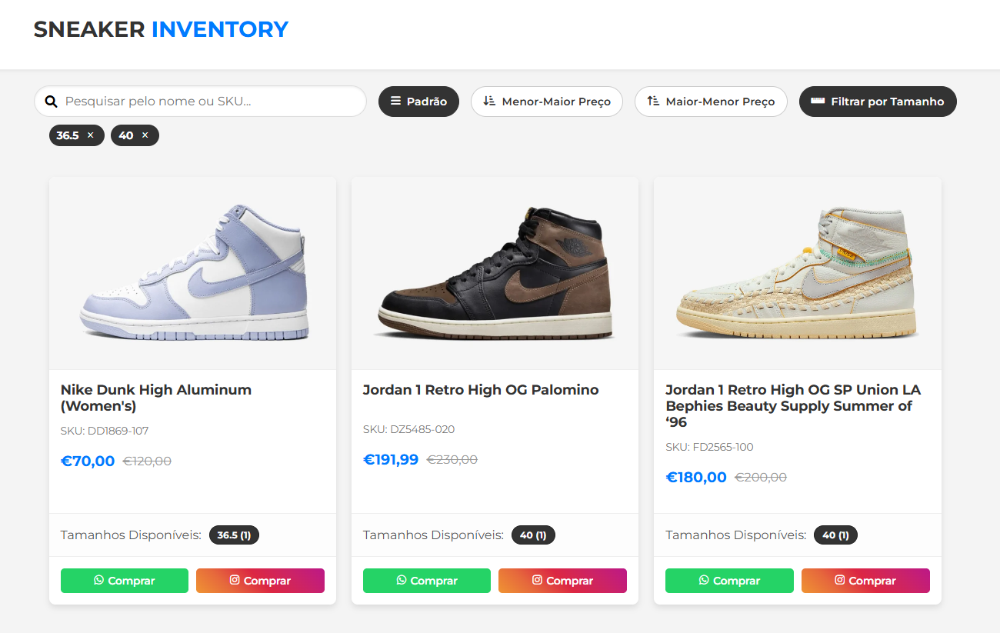
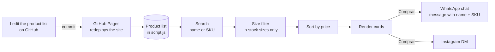

# Sneaker Inventory: a stock catalogue for reseller WhatsApp groups

**A one-page catalogue I share as a link in sneaker reseller groups: buyers see what's in stock, filter by their size, and tap "Comprar" to open a chat with the exact pair already named.**

**Live:** [davidr44.github.io/sneakerinventory](https://davidr44.github.io/sneakerinventory/)

> I built it in July 2025 for **44SNKRS**, my sneaker resale business, and I still use it now and then to move the remaining stock. It is deliberately **not a shop**: there is no cart, no checkout and no account. It shows the stock and starts the conversation; the sale happens in the chat.

**Stack:** HTML · CSS · vanilla JavaScript · GitHub Pages



---

## The problem

Portuguese sneaker resellers trade stock in WhatsApp groups, where most people are buyers or sellers doing business. Other resellers in those groups shared catalogue links, and I wanted my own: better looking, and built around my stock and how I sell.

What a buyer in those groups needs is simple: **what do you have in my size, for how much, and how do I get it?** And what I need is for the first message to tell me which pair they mean.

I already had an Instagram shop for regular customers. This catalogue is for a different audience, the resellers, and they buy by message.

---

## What it does

1. **Shows the stock** as a grid of cards: photo, name, SKU, price and the sizes available with quantity. A pair on promotion shows the old price struck through next to the new one.
2. **Search** by name or SKU, as you type.
3. **Sort** by price, low to high or high to low.
4. **Filter by size.** The filter only offers sizes that are actually in stock, split into footwear (EU) and clothing. You can pick several sizes, apply them, and remove each one from a chip.
5. **Buy by message.** "Comprar" on WhatsApp opens a chat with me and a message already written: *"Olá, tenho interesse no adidas Campus 00s Core Black (SKU: HQ8708)"*. The other button opens an Instagram DM.

**What the buyer sees after tapping "Comprar" on WhatsApp.** The message is ready; they only press send.



**Filtering by size.** Sizes 36.5 and 40 applied: only pairs in stock in those sizes stay, and each chip removes its size.



---

## Architecture



| Layer | Tool | Role |
|---|---|---|
| Data | A JavaScript array at the top of `script.js` | One object per product: name, SKU, price, optional old price, photo, sizes with quantity, category |
| Logic | Vanilla JavaScript | Search, size filter, sort, rendering, building the WhatsApp message |
| Hosting | GitHub Pages | Free static hosting; every commit to `main` redeploys |
| Contact | `wa.me` and `ig.me` links | Open WhatsApp or Instagram on the buyer's phone, no API involved |

---

## Key decisions and why

### 1. A link that starts a conversation, not a shop

The people I sell to through this catalogue buy by message, so a cart and a checkout would add steps nobody uses. Every product ends in "Comprar", which opens a chat. That also ruled out Shopify or a similar platform: I wasn't going to sell through the site, so I didn't need what those platforms charge for.

**Trade-off:** there is no order record or stock reservation. Every sale is a manual conversation, and I update the stock by hand afterwards.

### 2. Built from scratch, to look better than what was out there

I had seen other resellers' catalogue links in the groups, and I wanted mine to look better and be fully mine: my design, my layout for each card, and a buying flow built around WhatsApp. Building it from scratch was the way to control all of that.

### 3. The first message names the product

The WhatsApp link carries a prefilled message with the product name and SKU. The buyer only has to press send, and I know exactly which pair they mean. Products without a SKU (a cap, for example) send the name only.

### 4. The size filter only offers what can be bought

The footwear sizes in the filter are generated from the stock, not from a fixed list, so a buyer never picks a size and gets an empty page. EU sizing mixes halves and thirds (`38.5`, `36 2/3`, `39 1/3`), so sizes are converted to numbers before sorting. Otherwise `36 2/3` would land in the wrong place.

Sizes picked in the filter only apply when you press "Aplicar Filtro". Closing the filter without applying discards them, and the applied sizes stay visible as chips you can remove one by one.

### 5. Data in the code, no backend

The whole catalogue is three static files on GitHub Pages. That means no server, no database and no cost. **Trade-off:** every change of price or stock is a code edit. The commit history shows it: most commits are price updates, promotions and sold pairs coming off the list.

### 6. Photos linked from the web

Product photos are linked from retailer and marketplace pages instead of being shot and hosted by me. That made adding a pair quick. **Trade-off:** those links can break, and the photos are not mine. If one fails to load, the card shows a neutral placeholder instead of a broken image.

---

## November 2026 cleanup

Before using this repo as portfolio evidence, I reviewed the code and fixed what I found. The full diff is in the commit.

- **The font never loaded.** The CSS asked for Montserrat, but the page never imported it, so it rendered in the system font.
- **The clothing filter offered sizes nobody had.** It listed XS to XXL from a fixed list. It is now generated from stock, like footwear, and a section with no sizes is hidden.
- **Sort and size filter now work together.** Opening the size filter used to remove the highlight from the active sort while the sort stayed applied. Now each button shows its own state.
- **One-size items** showed "N/A" as a size and "SKU: N/A". They now show "Tamanho único" and no SKU line.
- **Mobile layout.** The search box overflowed the screen by a few pixels, and four full-width buttons pushed the first product far down. The three sort buttons now share one row.
- **Link preview.** Open Graph tags give the link a title and description when it is pasted into WhatsApp.
- **Code quality.** About half of the CSS rules were defined twice, the second copy silently overriding the first. Rewritten as one stylesheet with the same look. Product data is escaped before it goes into the page, and external links use `rel="noopener"`.

---

## How I built it

The 2025 version was built with Google Gemini, which wrote most of the code. I owned the product: who it's for, that it should be a catalogue and not a shop, what each card shows, how buying works, and how it looks. I reviewed every version, decided what was good, what wasn't and what to change, and kept iterating until it worked the way I wanted. That took a long time. Since then I've kept it up to date myself, editing the product list directly on GitHub.

The November 2026 cleanup was done with Claude (Anthropic) as a pair programmer, which is why that commit is co-authored. I decided what to fix and why. The changes were checked in a headless browser at phone and desktop sizes: search, sort, the size filter, the chips, the WhatsApp message and the image fallback.

---

## Repo contents and running it locally

```
index.html    page structure, metadata and link preview
style.css     all styles, mobile rules at the end
script.js     the product list at the top, then the catalogue logic
```

There is no build step and no dependencies. Open `index.html` in a browser, or serve the folder:

```
python3 -m http.server 8000    # then open http://localhost:8000
```

To update the stock, edit the `products` array at the top of `script.js`. When `originalPrice` is set, the card shows it struck through as the old price.

---

## Limitations and next steps

- **Updating stock means editing code.** Reading the products from a Google Sheet would let anyone update the catalogue from a spreadsheet, with no commit.
- **The message doesn't include the size.** A buyer can see the sizes but has to type which one they want. Tapping a size could add it to the message.
- **Photos depend on other sites.** Hosting my own photos in the repo would remove that dependency.
- **No numbers.** I don't measure visits or taps on "Comprar", so I can't say how many conversations the catalogue started. A simple, privacy-friendly counter would answer that.

---

## What this project shows

- Building for a **specific audience and channel**: resellers who buy by WhatsApp, not shoppers who expect a checkout.
- **Vanilla JavaScript without a framework**: state, filtering, sorting and rendering by hand.
- Handling **messy real data**: EU sizes in halves and thirds, one-size items, products without a SKU.
- Being clear about **trade-offs** and about what was built with AI and what was decided by me.

---

**Contact:** [LinkedIn](https://www.linkedin.com/in/daviddr44/) · [davidribeiro.me](https://davidribeiro.me/) · daviddr3023@gmail.com

© 2025–2026 David Ribeiro. The code is released under the [MIT License](LICENSE). Product photos belong to their owners and are not covered by it. Not affiliated with Nike, adidas or any brand shown.
